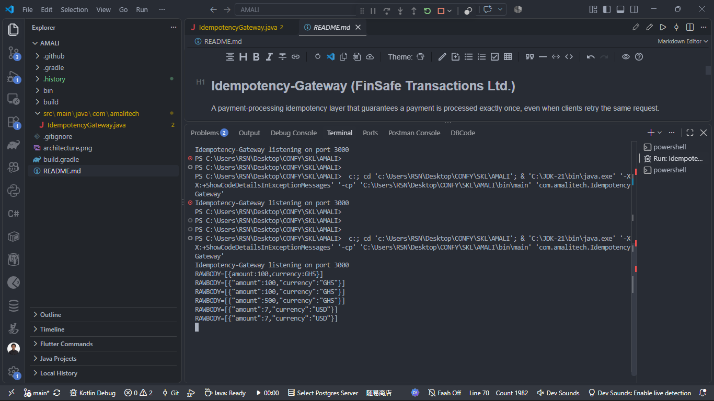

# Idempotency-Gateway (FinSafe Transactions Ltd.)

A payment-processing idempotency layer that guarantees a payment is processed exactly once, even when clients retry the same request.

## Architecture Diagram


## Setup Instructions

Prerequisites: JDK 17+ and Gradle.

Run:

```
gradle run
```

Or compile and run manually:

```
javac -d out src/main/java/com/amalitech/*.java
java -cp out com.amalitech.IdempotencyGateway
```

Server listens on `http://localhost:3000`.

## API Documentation

### POST /process-payment

Headers:
- `Idempotency-Key: <unique-string>` (required)

Body:
```json
{"amount": 100, "currency": "RWF"}
```

Responses:
- `201 Created` `{"message":"Charged 100 RWF"}` (first request)
- `201 Created` + `X-Cache-Hit: true` (duplicate, cached)
- `422 Unprocessable Entity` `{"error":"Idempotency key already used for a different request body."}` (key reuse with different body)
- `400 Bad Request` (missing key or invalid body)

### GET /health
Returns `{"status":"ok"}`.

## Design Decisions

- In-memory `ConcurrentHashMap` keyed by idempotency key; per-entry lock with `wait()/notifyAll()` handles in-flight (bonus) race conditions.
- Request body is hashed (SHA-256) for exact duplicate detection; mismatched payloads are rejected with 422.
- Keys expire after 24 hours (TTL) with periodic cleanup (Developer's Choice) to bound memory and prevent stale replays.
- No external dependencies; uses JDK built-in `com.sun.net.httpserver`.

## Developer's Choice

**Idempotency-Key TTL (24h) with automatic cleanup.** Real payment systems must not retain idempotency keys forever; expiring them bounds memory usage while still covering realistic retry windows. Cleanup runs every minute.

## Git Hygiene

Multiple commits with meaningful messages are used throughout development.

## Sample Run

``nIdempotency-Gateway listening on port 3000
RAWBODY=[{"amount":100,"currency":"RWF"}]
{"message":"Charged 100 RWF"}
``n



